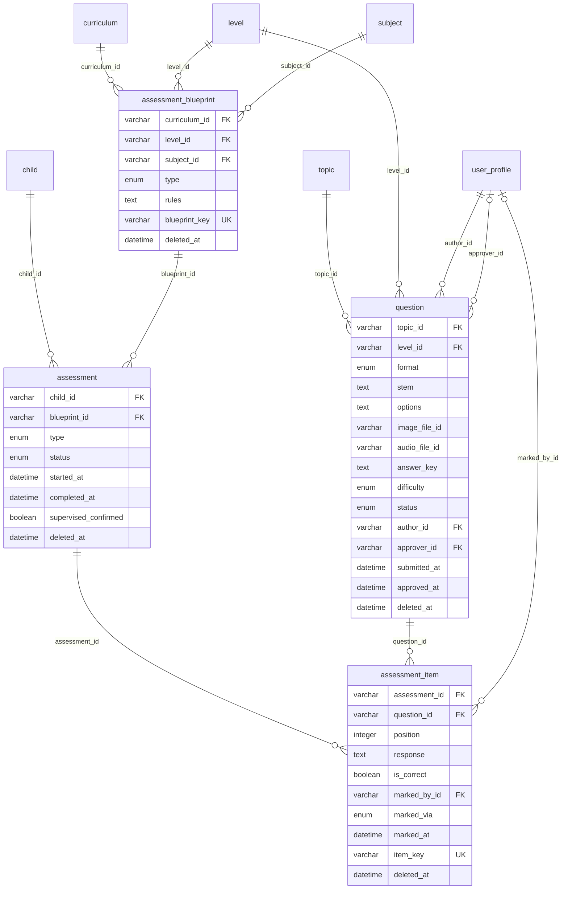

<!-- GENERATED by appwrite/schema_build.py from appwrite/schema/assessments.json. Do not edit; run `python3 appwrite/schema_build.py --write`. -->
# ERD: assessments

M03 (#38): question bank (two-person approval), assessment blueprints, assessments and items (SR 5.3, 7.7). Child data in assessment and assessment_item: per-row grants only.

## Tables

- `question` (soft): Written and approved by people (no AI generation, SR 7.7). status draft -> in_review -> approved -> retired. Two-person rule: approver_id must differ from author_id and an approved row has approver_id and approved_at (catalogue_rules.assert_two_person, approve_question, validate_question_row); enforced by the core service, the schema cannot compare two columns. The approver must be a curator or senior teacher (core role check). Only approved questions enter assessments. options is JSON text; answer_key is JSON text and is NEVER sent to the parent app before the item is submitted. image_file_id/audio_file_id are Storage ids in bucket question-media (lower primary picture/read-aloud). topic_id belongs to one catalogue version; a question is not carried across versions automatically.
- `assessment_blueprint` (soft): Fixed blueprint per curriculum, level and subject and type (practice, checkpoint): rules is JSON text (topic coverage, difficulty mix, item count). blueprint_key '<level>:<subject>:<type>' (the level and subject belong to one catalogue version, so the curriculum follows).
- `assessment` (soft): Child data (sensitive). A practice check or checkpoint taken on the parent's device; supervised_confirmed is the parent's supervision confirmation (required for checkpoints, core rule). completed_at UTC.
- `assessment_item` (soft): One question in one assessment (item_key '<assessment>:<question>'), with the child's response, is_correct (null until marked) and who marked it: objective items auto-marked (marked_via auto, marked_by_id null), short answers by a curator who is not the child's own teacher (core rule, ASM-7). Child data.
