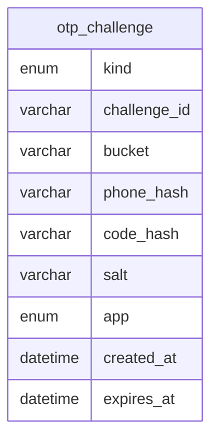

<!-- GENERATED by appwrite/schema_build.py from appwrite/schema/auth.json. Do not edit; run `python3 appwrite/schema_build.py --write`. -->
# ERD: auth

Phone OTP challenges, attempt slots and rate-limit slots owned by the core service (A01, SR SEC-7). Server-only and short-lived: every row carries expires_at and the hourly otp-cleanup job hard-deletes expired rows. Holds only salted/peppered hashes: never a code, a phone number or an IP address.

## Tables

- `otp_challenge` (hard): Short-lived security rows, hard-deleted by the otp-cleanup job after expires_at plus a 1 hour grace. kind=challenge: one per SMS sent (row id random, code_hash = HMAC(pepper, challenge|salt|code)); kind=attempt: one per verification try, row id derived from (challenge, n) so concurrent tries claim distinct slots (Appwrite 409 on duplicates); kind=consume: row id derived from the challenge, created once when the code is redeemed (the single-use claim); kind=bucket: rate-limit slot, row id derived from (bucket, n). phone_hash is HMAC(pepper, phone): the number is never stored here. challenge_id is a self reference, not a user.
