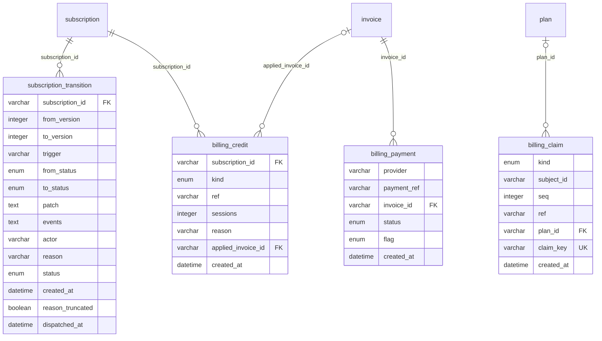

<!-- GENERATED by appwrite/schema_build.py from appwrite/schema/billing.json. Do not edit; run `python3 appwrite/schema_build.py --write`. -->
# ERD: billing

Subscription lifecycle and billing support tables (B03, SR 5.2, 7.8, PRD SUB-3..SUB-5). Created-once claim rows (deterministic ids) give optimistic concurrency and idempotency where Appwrite has no conditional update. Money is not stored here (credits are session counts; invoice amounts stay on M04 invoice, integer UGX). No table is soft-deletable; tables are written by the core service only (no client permission, row security on).

## Tables

- `subscription_transition` (hard): B03 optimistic-concurrency claim and history of every subscription change. Appwrite has no conditional update, so a writer that read version v creates the row with the deterministic id sha256(subscription, v+1): the second creator gets 409 and loses (ConcurrentTransition); unique (subscription_id, to_version) is the backstop. patch (the subscription columns to set, JSON text) and events (domain event names, JSON text) let a claim whose writer died be rolled forward by the core service after a lease. status moves claimed -> applied -> delivered (delivered = the post-commit effects were completed and the domain events handed to their consumers; dispatched_at is that instant); no other column changes after the insert, so this is not marked append-only. A sweep re-delivers claims that are not delivered; event ids are <subscription>:<to_version>:<index>, so consumers de-duplicate. reason_truncated is true when the free-text reason was cut to 200 characters. No personal data: ids, statuses and an actor id. Never soft-deleted: a soft delete would either hide a financial/idempotency record or free its unique value. Only the retention job hard-deletes it, after the retention period (DP-6, SR 5.5). Not reusing M04 audit_log: that table is the audit trail (M06); this one is the concurrency primitive and must exist even if audit is unavailable.
- `billing_credit` (hard): SUB-5: sessions owed to a subscription after a platform-caused miss (kind platform_miss, ref = session id) or a payment after the period start (kind late_payment_start, ref = invoice id). Unique (subscription, kind, ref): reporting the same miss twice cannot credit twice. applied_invoice_id is set once, when the next invoice consumes the credit (never re-assigned). The money value is derived at application (plan price // sessions included, integer UGX) and posted to the ledger, so no money column is stored here. Never soft-deleted: a soft delete would either hide a financial/idempotency record or free its unique value. Only the retention job hard-deletes it, after the retention period (DP-6, SR 5.5). Not reusing ledger tables: a credit is a pending entitlement, not a posting.
- `billing_payment` (hard): Application of one confirmed provider payment to an invoice, claimed by the deterministic id sha256(payment_ref): a duplicate callback is a 409 and returns the earlier outcome. status applying -> applied|flagged; flag says why a confirmed payment was NOT applied (it goes on the ledger refund queue, PAY-7). unique (provider, payment_ref) backstops the id and matches M04 payment's unique (provider, provider_reference); a reconciliation function compares every applied row with its M04 payment. Kept separate from M04 payment: that row records the provider request and callback (written by the MoMo flow, #78/#114) and may not exist when billing is told of a confirmation; this row records what billing did with it. Never soft-deleted: a soft delete would either hide a financial/idempotency record or free its unique value. Only the retention job hard-deletes it, after the retention period (DP-6, SR 5.5).
- `billing_claim` (hard): Create-once claims that need no table of their own: kind credit_applied (subject = credit id, ref = the invoice that reserved it: a credit is taken by exactly one invoice),  kind invoice_paid (subject = invoice id, ref = provider:reference of the payment that won; a second different payment for the invoice loses and is flagged) and kind child_live (subject = child id, seq = n-th subscription of the child, ref = subscription id, plan_id: a double tap or race on the same child gets 409 and returns the live subscription; a cancelled one lets seq+1 be claimed). Row id = sha256(kind, subject, seq); claim_key = kind:subject[:seq] is the unique backstop. One table instead of two (reduced surface). Never soft-deleted: a soft delete would either hide a financial/idempotency record or free its unique value. Only the retention job hard-deletes it, after the retention period (DP-6, SR 5.5).
