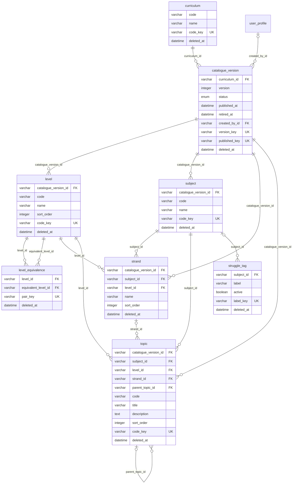

<!-- GENERATED by appwrite/schema_build.py from appwrite/schema/catalogue.json. Do not edit; run `python3 appwrite/schema_build.py --write`. -->
# ERD: catalogue

M03 (#38): curriculum catalogue (SR 5.3, 7.8): curricula, versioned levels, subjects, strands and topics, level equivalence, struggle tags. Published versions are immutable (core-service rule; no client write permission). Unique values use derived *_key columns (soft-delete convention in appwrite/README.md).

## Tables

- `curriculum` (soft): code (UG, CAM, US) and name. Reference data maintained by curators through the core service (curators have no direct write permission). code_key = lower-case code, nulled on soft delete.
- `catalogue_version` (soft): status draft -> published -> retired (CUR-2). A PUBLISHED or RETIRED version and everything under it (levels, subjects, strands, topics) is immutable: curators have no write permission on any table, and the core service rejects edits through catalogue_rules.assert_editable (only a draft is editable; publishing is the only way out of draft). New wording = a new draft version copied from the old one. version is an integer >= 1 per curriculum; version_key '<curriculum_id>:<version>' makes it unique. published_key = curriculum_id while status is published: at most one published version per curriculum; publishing a new one retires the old one (children stay on the version they were linked to, so retired versions keep resolving). published_at/retired_at UTC.
- `level` (soft): Per catalogue version (P4, Stage 3, Grade 3). sort_order is the display order. code_key '<version>:<code>'.
- `level_equivalence` (soft): Matching only (CUR-4): pairs of levels across curricula. pair_key is the two ids sorted and joined with ':' (catalogue_rules.level_pair_key), so A~B and B~A are one row. Equivalence is symmetric; the core service reads both columns.
- `subject` (soft): Per catalogue version (Maths, English, Science). code_key '<version>:<code>'.
- `strand` (soft): Optional grouping of topics within a subject and level of one version. Not in SR 5.3; the live project has it and topic.strand_id points here (owner question: keep).
- `topic` (soft): Platform's own wording (CUR-6). Belongs to a catalogue version (catalogue_version_id) and, through subject/level, to the same version (core service rule: subject, level, strand and parent_topic must be in the same version; catalogue_rules.check_topic_refs). parent_topic_id nests topics; sort_order orders siblings. code_key '<version>:<subject>:<level>:<code>'. A topic is never edited once its version is published: a topic retired in a new version is simply absent from the new version, the old row stays, and logs that reference it keep resolving (SR 5.5).
- `struggle_tag` (soft): Configurable list (CUR-5), optionally scoped to a subject; not versioned (SR 5.3). A tag is retired with active=false, not deleted, because logs reference it. label_key '<subject_id or all>:<lower-case label>'.
