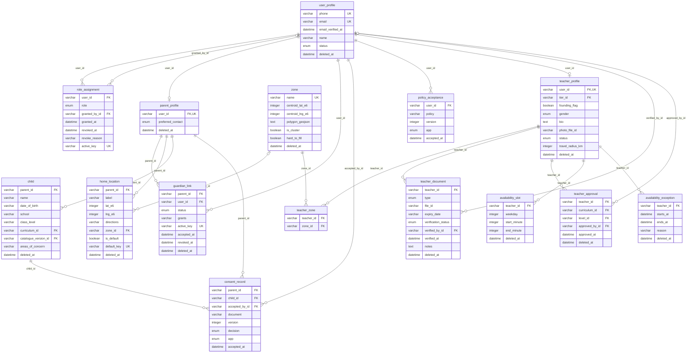

<!-- GENERATED by appwrite/schema_build.py from appwrite/schema/core.json. Do not edit; run `python3 appwrite/schema_build.py --write`. -->
# ERD: core

Users, roles, profiles, children, locations, consent, teachers, availability, zones (M01, SR 5.1).

## Tables

- `user_profile` (soft): Row $id equals the Appwrite auth user id. Roles live in Appwrite labels (authoritative) and role_assignment (history).
- `role_assignment` (history): Grant history. active_key = '<user_id>:<role>' while active, null once revoked: unique (user, role) among active grants and re-grant after revoke is possible.
- `parent_profile` (soft): One per parent user. Consent lives in consent_record (per child), not here.
- `guardian_link` (soft): Second guardian (Phase 2). active_key = '<parent_id>:<user_id>' while invited/active.
- `zone` (soft): Kampala neighbourhoods. Coordinates are integer micro-degrees (no floats). Zone names are not personal data.
- `home_location` (soft): Separate table from child (ADR 0012: audience split). Several per parent; default_key = parent_id on the single default row, null otherwise, so a second default is rejected by the unique index.
- `child` (soft): Sensitive. school and class_level are optional (child homeschooled abroad). No photo column (DP-3). areas_of_concern holds struggle tag ids. No unique name+date_of_birth: twins and re-adds are legitimate; duplicates are a core-service warning.
- `consent_record` (immutable): Insert-only. A withdrawal is a new row with decision=withdrawn. No client write permission, and the core service exposes no update or delete for it.
- `policy_acceptance` (immutable): Insert-only (teacher safeguarding policy, terms, privacy). Unique per user, policy and version, so a double submit is rejected.
- `teacher_profile` (soft): Zones are in teacher_zone. status becomes active only through the core service after all mandatory checks (SR 7.1). Bio is limited by the text column (16,383 chars max).
- `teacher_zone` (join): Pure join row; hard delete allowed (no history needed).
- `teacher_document` (soft): File lives in the private bucket teacher-docs (file permissions set by the core service). by_expiry serves the daily expiry job.
- `teacher_approval` (soft): One row per teacher, curriculum and level (SR lists level_ids as an array; rows are queryable and indexable for matching).
- `availability_slot` (soft): Weekly pattern. weekday is ISO (1=Monday). Minutes since midnight in Africa/Kampala wall-clock time (no DST), because it is a recurring pattern, not an instant; end > start is checked by the core service.
- `availability_exception` (soft): Leave and one-off unavailability, UTC instants.

## Relations to tables that arrive in later tickets

- `child.curriculum_id` -> `curriculum`: catalogue tables arrive with the curriculum ticket
- `child.catalogue_version_id` -> `catalogue_version`: catalogue tables arrive with the curriculum ticket
- `teacher_profile.tier_id` -> `tier`: tier table arrives with the money/tier ticket
- `teacher_approval.curriculum_id` -> `curriculum`: catalogue tables arrive with the curriculum ticket
- `teacher_approval.level_id` -> `level`: catalogue tables arrive with the curriculum ticket
