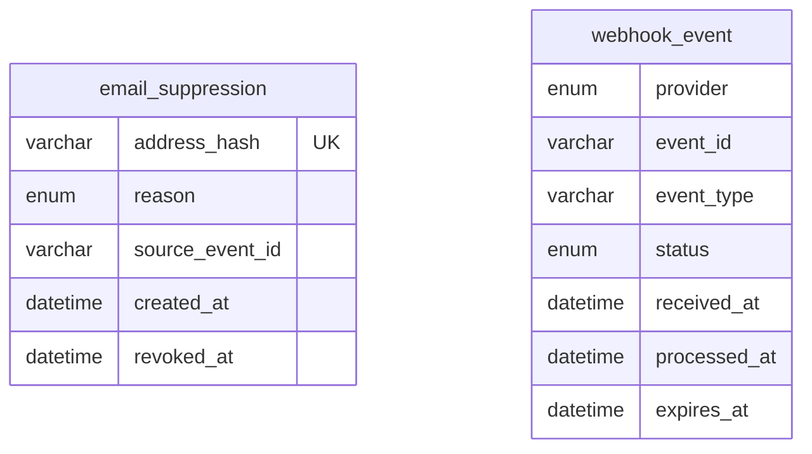

<!-- GENERATED by appwrite/schema_build.py from appwrite/schema/email.json. Do not edit; run `python3 appwrite/schema_build.py --write`. -->
# ERD: email

Email provider bookkeeping owned by the core service (N02, SR section 8): the suppression list (addresses we never email again) and the processed-webhook log that makes provider callbacks idempotent. Server-only: no table or row permissions, no address and no message content is stored (addresses are hashed).

## Tables

- `email_suppression` (history): Addresses that must never be emailed again: hard bounce, spam complaint, the provider's own suppression, or a manual entry. address_hash = sha256 hex of 'hs-email-suppression:' + the address lower-cased (a plain hash, no secret: it only needs to match at send time; with a copy of the table an attacker can test guesses of known addresses, so the table is server-only and has no read permission). Row $id = sha256(email_suppression, address_hash)[:36], so adding an address twice is idempotent (Conflict = already listed). Never removed: a release (support fixed a typo, the owner approves) sets revoked_at and the address may be emailed again until the provider reports a new bounce, which clears revoked_at. Applies to ALL email including safeguarding mail (owner default: safeguarding falls back to push/in-app and alerts an admin).
- `webhook_event` (hard): One row per processed provider webhook delivery, the replay and duplicate guard. Row $id = sha256(webhook_event, provider:event_id)[:36]; create is the atomic claim. status processing = claimed, effects may be half applied (a retry re-applies them, they are idempotent); done = finished, a repeat is acknowledged and ignored. No payload, address or recipient is stored. The webhook-event-cleanup job hard-deletes rows after expires_at (7 days, far longer than the 5 minute signature timestamp tolerance, so a replay of an old body fails the timestamp check before it needs the row).
