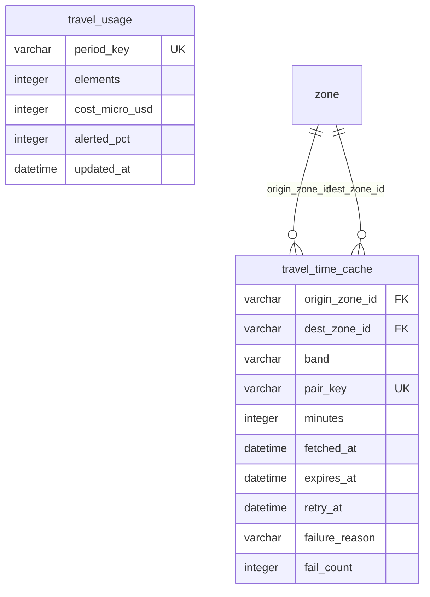

<!-- GENERATED by appwrite/schema_build.py from appwrite/schema/geo.json. Do not edit; run `python3 appwrite/schema_build.py --write`. -->
# ERD: geo

Travel-time cache and Google Routes usage counters (X01, SR 7.2 and 9). Zone ids and minutes only: no coordinates, no personal data.

## Tables

- `travel_time_cache` (hard): Derived cache, safe to delete or rebuild at any time (no soft delete, no *_key soft-unique rule needed). Row $id = sha256(travel_time_cache, origin, dest, band)[:36], so create is atomic and a lost race falls back to update. `minutes`/`fetched_at`/`expires_at` are the LAST GOOD value; a failure only sets retry_at/failure_reason/fail_count (negative cache), never erases the good value. pair_key = origin:dest:band (unique, informational: the row id already enforces it). Rows of retired zones are harmless and may be purged by the retention job.
- `travel_usage` (hard): One row per period_key `d:YYYY-MM-DD` (Africa/Kampala day) or `m:YYYY-MM`: provider elements used, estimated cost in micro-USD, highest alert percentage already sent. Read-modify-write without atomic increment: concurrent instances can overshoot a cap by about one batch (the Google Cloud budget and quota cap are the hard stop). Old rows may be purged after 13 months.
