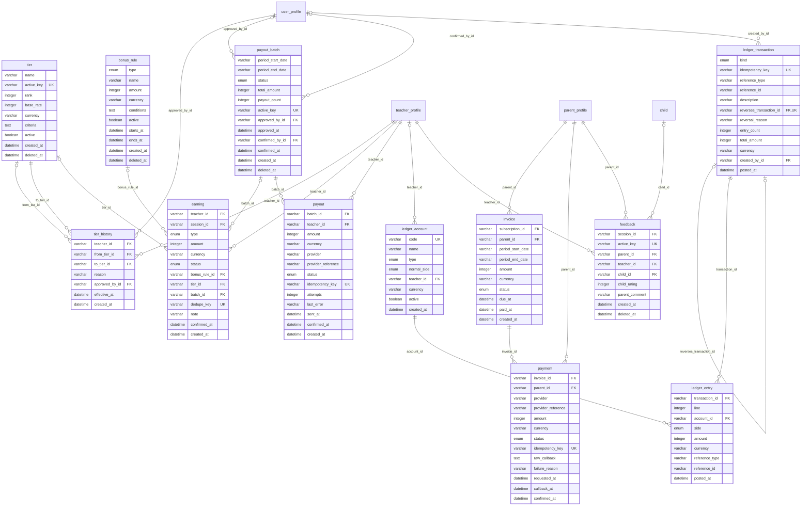

<!-- GENERATED by appwrite/schema_build.py from appwrite/schema/money.json. Do not edit; run `python3 appwrite/schema_build.py --write`. -->
# ERD: money

Tiers, bonuses, invoices, payments, earnings, payouts, double-entry ledger, feedback (M04, SR 5.4, 7.8-7.11). Money is integer UGX; instants are UTC. ledger_transaction and ledger_entry are append-only (no client write permission; core-service insert-only access is INTENDED via the opt-in AppendOnlyRepository, not wired yet, see appwrite/README.md). Soft-delete rule (M02): unique values on soft tables sit on derived nullable *_key columns; tables whose unique values must never be freed (payment, payout, invoice, earning, ledger_account) are not soft-deletable. The retention job is the only hard-deleter.

## Tables

- `tier` (soft): Rank order and base_rate (integer UGX per confirmed session); criteria is JSON text read by the monthly tier job. Soft-deleted tiers keep their unique name until restored or retention. Soft delete (M02 rule): active_key = lower-case name while the tier is live, set to null on soft delete (soft_delete_patch), so a deleted tier name can be re-created.
- `tier_history` (immutable): One row per tier change (TIR-4), approved by an admin; corrections are new rows. First assignment has no from_tier_id.
- `bonus_rule` (soft): Configurable bonus per confirmed session (TIR-5); amount is integer UGX; conditions is JSON text.
- `invoice` (hard): Created at period start. Unique (subscription, period start) makes the period job idempotent. parent_id is the payer (read grant). Voiding is a status, not a delete. Never soft-deleted (a soft delete would either hide a financial/idempotency record or free its unique value): the lifecycle is the status column; only the retention job hard-deletes it, after the retention period (DP-6, SR 5.5). Voiding is the status void. Retention: payment records are kept for the tax-law period (DP-6) even against a DP-5 deletion request; the conflict is Q4/Q16-17 in docs/legal/lawyer-brief.md (C04).
- `payment` (hard): idempotency_key UNIQUE (NFR-8): the core service claims the key by create (409 = already requested). provider_reference is unique per provider once known (NULLs allowed until then). raw_callback stores the verified provider callback verbatim (PAY-1..3, SR 7.8). Provider is free text on purpose: the owner has not chosen providers. Never soft-deleted (a soft delete would either hide a financial/idempotency record or free its unique value): the lifecycle is the status column; only the retention job hard-deletes it, after the retention period (DP-6, SR 5.5). idempotency_key and provider_reference stay claimed forever (NFR-8). Retention: payment records are kept for the tax-law period (DP-6) even against a DP-5 deletion request; the conflict is Q4/Q16-17 in docs/legal/lawyer-brief.md (C04).
- `earning` (hard): Created when a session is confirmed (SR 5.4). dedupe_key (e.g. <session>:<type>[:<rule>]) is unique so confirmation retries cannot double-pay. adjustment amounts may be negative. batch_id is set when the weekly payout batch takes the earning. Never soft-deleted (a soft delete would either hide a financial/idempotency record or free its unique value): the lifecycle is the status column; only the retention job hard-deletes it, after the retention period (DP-6, SR 5.5). dedupe_key stays claimed (no double pay); cancel = status void.
- `payout_batch` (soft): Weekly batch (SR 7.9). active_key = period start date while the batch is not cancelled, NULL after, unique: one live batch per period (M01 active_key pattern). SEC-11: approved_by plus a distinct second confirmation (confirmed_by/confirmed_at); the core service rejects approver == confirmer.
- `payout` (hard): One payout per (batch, teacher); idempotency_key UNIQUE (NFR-8). Failures retry on the same row and end in needs_ops. The teacher's payout number lives with the teacher profile (re-verification and 48 h hold, SEC-11, are a core-service rule outside this ticket). Never soft-deleted (a soft delete would either hide a financial/idempotency record or free its unique value): the lifecycle is the status column; only the retention job hard-deletes it, after the retention period (DP-6, SR 5.5). idempotency_key stays claimed (NFR-8); failure = status. Retention: payment records are kept for the tax-law period (DP-6) even against a DP-5 deletion request; the conflict is Q4/Q16-17 in docs/legal/lawyer-brief.md (C04).
- `ledger_account` (hard): SR 7.10 minimum accounts plus one teacher payable per teacher (teacher_id set). code is unique, e.g. cash:mtn_momo, teacher_payable:<teacher_id>. Balances are derived from ledger_entry, never stored. Never soft-deleted (a soft delete would either hide a financial/idempotency record or free its unique value): the lifecycle is the status column; only the retention job hard-deletes it, after the retention period (DP-6, SR 5.5). code is never reused; retire with active=false. The M04 migration seeds no rows: the ledger service ($01 #76) must create the SR 7.10 accounts (parent receivables, cash at MTN MoMo / Airtel / card gateway, teacher payables per teacher via teacher_id, platform revenue, refunds and credits, provider fees).
- `ledger_transaction` (immutable): APPEND-ONLY header of a balanced posting (SR 7.10). Core-service rules (owner: $01 #76, not enforceable in Appwrite): sum(debit amounts) == sum(credit amounts) == total_amount, entry_count == number of lines, all in one currency, integer UGX > 0; idempotency_key unique so a retried posting cannot double post; corrections are a new transaction with kind=reversal and reverses_transaction_id (unique: reversed once). reference_type/reference_id are polymorphic (payment, earning, payout...). INTENDED insert-only via AppendOnlyRepository (opt-in, not wired yet: nothing uses it; see appwrite/README.md).
- `ledger_entry` (immutable): APPEND-ONLY line of a transaction: one side (debit or credit) and a positive integer UGX amount. Unique (transaction_id, line). No client write permission. INTENDED insert-only via AppendOnlyRepository (opt-in, not wired yet: nothing uses it; see appwrite/README.md). Write all lines first, the header last so a crash leaves no header over partial lines (reconciliation job flags orphan lines).
- `feedback` (soft): Parent/child feedback after a session (SR 5.4, SAF-3). child_rating 1..5 (face rating). teacher_id/child_id denormalised from the session so tier evaluation can query without a join. A 'something felt wrong' answer additionally creates a safeguarding_case in the core service. Soft delete (M02 rule): active_key = '<session_id>:<parent_id>' while live, null after soft delete: one live feedback per session and parent.

## Relations to tables that arrive in later tickets

- `invoice.subscription_id` -> `subscription`: subscription table arrives with the plans/subscriptions ticket (M03)
- `earning.session_id` -> `session`: session table arrives with the scheduling ticket (M03)
- `feedback.session_id` -> `session`: session table arrives with the scheduling ticket (M03)
