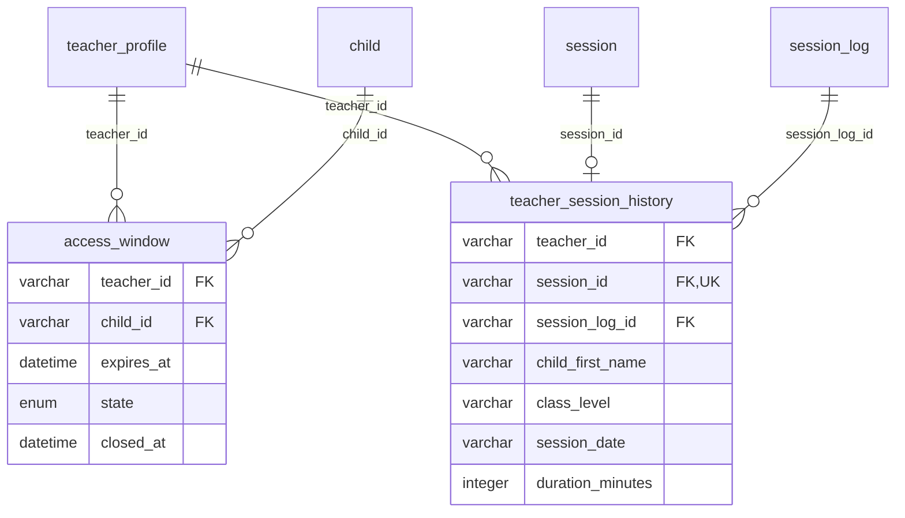

<!-- GENERATED by appwrite/schema_build.py from appwrite/schema/permissions.json. Do not edit; run `python3 appwrite/schema_build.py --write`. -->
# ERD: permissions

M05 (#40): bookkeeping for the permission service (ADR 0012). access_window records when a teacher's time-limited access (assignment end, substitute cover, 24 h address rule) lapses so the address-revoke job finds due rows by index; teacher_session_history is the anonymised copy of a session log a teacher keeps after the assignment ends (child first name, class, date, duration). Both are written only by the core service; no client write permission, no table-level read.

## Tables

- `access_window` (hard): One row per (teacher, child): the earliest future instant at which any of the teacher's time-limited access to the child (child record and logs: assignment end or substitute window; home address: 24 h after the last session) lapses. state open while a lapse is pending, closed once the permissions were recomputed after it. Written by the core permission service on every recompute of the child's scope; the address-revoke job reads state=open and expires_at <= now through index by_due. It is an optimisation for discovery only: the permissions themselves are always computed from business state, so a missing or stale row is repaired by permission-reconcile and caught by permission-audit. No client read.
- `teacher_session_history` (hard): ADR 0012 history rule: when a teacher's assignment ends the teacher loses the child's session_log, but keeps this redacted row (child first name only, class, Kampala calendar date, duration in minutes) for their own earnings history. Written by the core service in the same step as a log submit (permissions.history.build_history_row). read(user:<teacher>) only, plus read(label:opsadmin). Unique per session so a resubmitted log updates one row. Removed by the retention job with the teacher or on a DP-5 request for the child (the first name is personal data of the child).
