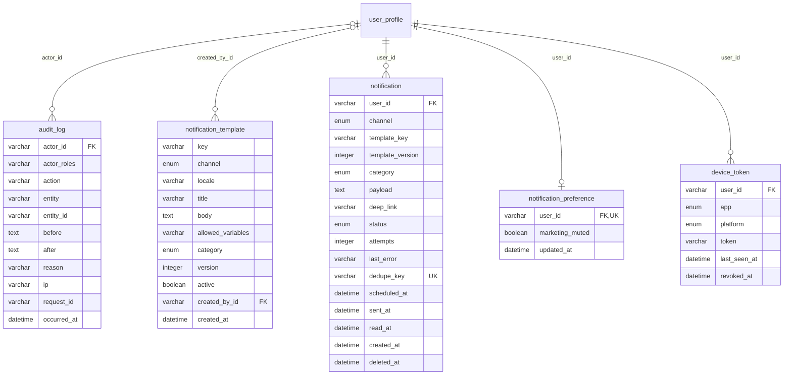

<!-- GENERATED by appwrite/schema_build.py from appwrite/schema/platform.json. Do not edit; run `python3 appwrite/schema_build.py --write`. -->
# ERD: platform

Audit log, notifications, templates, preferences and device tokens (M04, SR 5.4, 8, SEC-6). audit_log is append-only.

## Tables

- `audit_log` (immutable): APPEND-ONLY (SEC-6): who (actor_id, actor_roles), what (action, entity, entity_id), before/after JSON text, reason, ip, request_id, occurred_at (UTC). Read: opsadmin and safeguardinglead via per-row read grants written by the core service (no table-level label read). Insert-only in the core service (AppendOnlyRepository). Index prefix for lookups: (entity, entity_id, occurred_at); actor_id is NULL for system actions.
- `notification_template` (immutable): Central templates with variables per channel (SR 8, N01 #126 builds the service on this table). Editing = new version row (unique key+channel+locale+version), so sent notifications keep the exact version. allowed_variables lists the placeholders a body may use (missing variable blocks the send, N01). Super admin edits through the core service.
- `notification` (soft): One row per send with delivery status (SR 5.1/8). category operational and safeguarding cannot be muted; marketing can (N01). dedupe_key unique so a retried job does not send twice. Push failures for critical events fall back to email (status fallback). Rows are kept until retention.
- `notification_preference` (hard): Marketing mute only (SR 8). The one user-writable table in ADR 0012 item 2 (update(user:<id>) on the row, set by the core service when it creates the row). Never soft-deleted (a soft delete would either hide a financial/idempotency record or free its unique value): the lifecycle is the status column; only the retention job hard-deletes it, after the retention period (DP-6, SR 5.5). One row per user (unique user_id); removed with the user under retention.
- `device_token` (history): FCM tokens per user and app; revoked_at on logout or invalid token, row kept for history until retention.
