<!-- GENERATED by appwrite/schema_build.py from appwrite/schema/records.json. Do not edit; run `python3 appwrite/schema_build.py --write`. -->
# ERD: records

M03 (#38): session logs, topic progress, school uploads and handover summaries (SR 5.3, 7.6). Child data: no table-level read for anyone; per-row grants set by the core service. Logs reference topics of the child's catalogue version, so history survives catalogue changes.

```mermaid
erDiagram
  session_log {
    varchar session_id FK
    varchar teacher_id FK
    datetime submitted_at
    text note
    text homework
    datetime edited_at
    varchar session_key UK
    datetime deleted_at
  }
  session_log_topic {
    varchar session_log_id FK
    varchar topic_id FK
    enum mastery
    varchar log_topic_key UK
    datetime deleted_at
  }
  session_log_struggle {
    varchar session_log_id FK
    varchar struggle_tag_id FK
    varchar topic_id FK
    varchar log_struggle_key UK
    datetime deleted_at
  }
  topic_progress {
    varchar child_id FK
    varchar topic_id FK
    enum current_mastery
    varchar last_session_id FK
    datetime updated_at
  }
  school_upload {
    varchar child_id FK
    enum type
    varchar file_id
    varchar uploaded_by_id FK
    datetime uploaded_at
    datetime deleted_at
  }
  handover_summary {
    varchar child_id FK
    varchar teacher_id FK
    varchar assignment_id FK
    varchar session_id FK
    varchar source_key UK
    datetime snapshot_at
    text content
  }
  handover_rating {
    varchar handover_summary_id FK
    varchar teacher_id FK
    boolean useful
    datetime created_at
  }
  session ||--o{ session_log : "session_id"
  teacher_profile ||--o{ session_log : "teacher_id"
  session_log ||--o{ session_log_topic : "session_log_id"
  topic ||--o{ session_log_topic : "topic_id"
  session_log ||--o{ session_log_struggle : "session_log_id"
  struggle_tag ||--o{ session_log_struggle : "struggle_tag_id"
  topic |o--o{ session_log_struggle : "topic_id"
  child ||--o{ topic_progress : "child_id"
  topic ||--o{ topic_progress : "topic_id"
  session |o--o{ topic_progress : "last_session_id"
  child ||--o{ school_upload : "child_id"
  user_profile ||--o{ school_upload : "uploaded_by_id"
  child ||--o{ handover_summary : "child_id"
  teacher_profile ||--o{ handover_summary : "teacher_id"
  assignment |o--o{ handover_summary : "assignment_id"
  session |o--o{ handover_summary : "session_id"
  handover_summary ||--o{ handover_rating : "handover_summary_id"
  teacher_profile ||--o{ handover_rating : "teacher_id"
```

## Tables

- `session_log` (soft): Child data (sensitive): what was taught. One per session: unique index on session_key = session_id (nulled on soft delete); a resubmission after an offline retry finds the existing log by session and updates it (idempotent submit, SR 7.6), edited_at marks the edit. note and homework are free text from the teacher. Written only by the core service on behalf of the session's teacher; read grants per row (parent of the child, the teacher, admins), never at table level.
- `session_log_topic` (soft): Topics covered with mastery (not_yet, developing, secure). topic_id is a topic of the CHILD's catalogue version (SR 5.5; catalogue_rules.assert_topic_in_child_version), so later catalogue versions never rewrite history: a topic retired in a new version stays resolvable through its old row. log_topic_key '<log>:<topic>': a topic once per log.
- `session_log_struggle` (soft): Struggle tags raised in a log, optionally tied to a topic. log_struggle_key '<log>:<tag>:<topic or ->'.
- `topic_progress` (hard): Derived (SR 5.3), rebuildable from logs and assessments: current mastery per child and topic, updated in the same core-service step as a log submit (no Appwrite transaction is relied on; a rebuild job repairs a half-applied update). Raw unique (child_id, topic_id): the only soft-delete-free table of the domain, because a row is cheap to rebuild and nothing references it; the retention job removes a child's rows.
- `school_upload` (soft): Child data (sensitive): school report or current topics, file in bucket school-reports (file_id is an Appwrite Storage id, not a row relation). Per-row read grants only; bucket has fileSecurity and no client permissions.
- `handover_summary` (immutable): Snapshot generated when an assignment or substitute offer is accepted (SR 7.6): snapshot_at (SR: generated_at, renamed for the same reason) UTC; content is structured JSON text (child summary, last 5 sessions per subject, open struggles, homework, latest assessments, school documents). Insert-only so the snapshot is what the teacher saw. source_key 'assignment:<id>' or 'session:<id>' makes generation idempotent. Child data: per-row read for the receiving teacher and admins.
- `handover_rating` (immutable): A teacher's (teacher_id = the rating teacher; SR calls it rated_by_teacher_id, renamed because the validator reserves names containing 'rate' for money) useful/not-useful rating of a handover; unique (summary, teacher), insert-only.
