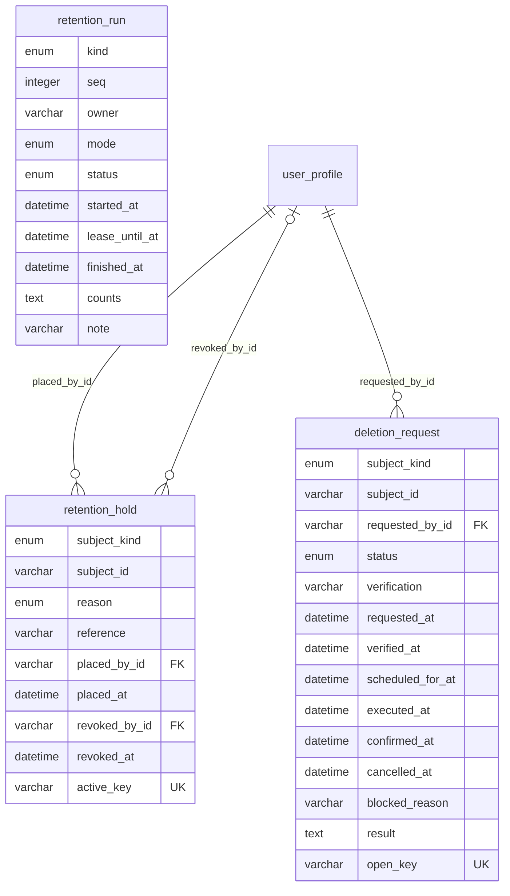

<!-- GENERATED by appwrite/schema_build.py from appwrite/schema/retention.json. Do not edit; run `python3 appwrite/schema_build.py --write`. -->
# ERD: retention

C03 (#141): retention enforcement bookkeeping (DP-5, DP-6). retention_hold blocks purging for a subject or one row (legal hold, safeguarding); deletion_request is the data-subject deletion lifecycle (C05 owns the user-facing flow); retention_run holds the purge job's lease generations and its per-run summaries. Server-only: no client permission, no table-level read. Holds ids, counts and states, never personal data.

## Tables

- `retention_hold` (history): A hold stops the retention job (and the deletion executor) from purging or anonymising any row that belongs to the subject: child, parent, teacher, user, safeguarding case, or one row ('table:id'). Placed and revoked by staff through the core service only (SEC-6 audited), never deleted; revoked_at set when lifted. active_key = '<subject_kind>:<subject_id>:<reason>' while active, null once revoked (unique among active holds, a revoked hold can be placed again). reference is a case or matter number, never a name or a description of the child. Open safeguarding cases are an implicit hold even without a row here (retention/holds.py).
- `deletion_request` (hard): Data-subject deletion lifecycle (DP-5): requested -> verified (identity re-confirmed) -> scheduled (grace period before anything is deleted, scheduled_for_at) -> executed -> confirmed (the requester was told). cancelled while still before executed; blocked when a legal or safeguarding hold applies (blocked_reason carries the code only). open_key = '<subject_kind>:<subject_id>' while the request is open, null once executed, confirmed, cancelled or blocked-and-closed: one open request per subject. result holds counts per table of what was deleted, anonymised and retained (never values). The row itself is kept as proof of the request and purged by the retention job after its period. C05 (#143) owns the user flow; the executor is hs_core.retention.deletion.
- `retention_run` (hard): kind=lease: one row per lease generation of the purge job (row id 'lease-<seq>', created atomically, so exactly one concurrent run holds generation n; lease_until_at is when a crashed holder is replaced by generation n+1). kind=run: one summary per purge run (mode dry_run or enforce, status, counts per table: scanned, deleted, anonymised, quarantined, held, skipped, errors). Read by the purge guard (clock sanity: now must not be earlier than the last run). No personal data. Purged by the retention job after its period.
