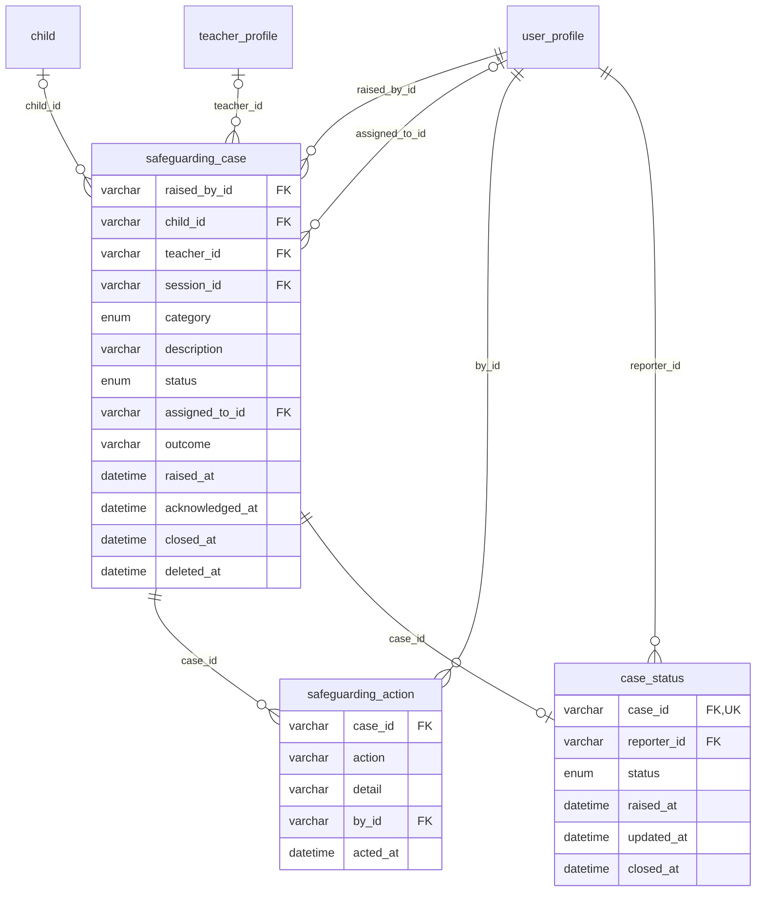

<!-- GENERATED by appwrite/schema_build.py from appwrite/schema/safeguarding.json. Do not edit; run `python3 appwrite/schema_build.py --write`. -->
# ERD: safeguarding

Safeguarding cases, their append-only action log and the reporter-visible status (M04, SR 5.4, 7.12, ADR 0012 scope rule). Strictest permissions: empty table permissions and per-row grants to the assigned lead only.

## Tables

- `safeguarding_case` (soft): RESTRICTED (ADR 0012): no table permission at all; the core service writes each row with read(user:<assigned lead>) per case only (no label read on the table: safeguarding scope rule). Reporters never read this row; they read case_status. Writes by the core service only. The involved teacher is never notified automatically (SAF-4).
- `safeguarding_action` (immutable): APPEND-ONLY case log (SAF-5, SR 5.4). Same restricted per-row grants as the case. Insert-only in the core service (AppendOnlyRepository).
- `case_status` (hard): What the reporter may see (ADR 0012): reference, status and dates only, no content. read(user:<reporter>) plus the case's lead. Never soft-deleted (a soft delete would either hide a financial/idempotency record or free its unique value): the lifecycle is the status column; only the retention job hard-deletes it, after the retention period (DP-6, SR 5.5). One row per case (unique case_id); removed with the case under retention.

## Relations to tables that arrive in later tickets

- `safeguarding_case.session_id` -> `session`: session table arrives with the scheduling ticket (M03)
