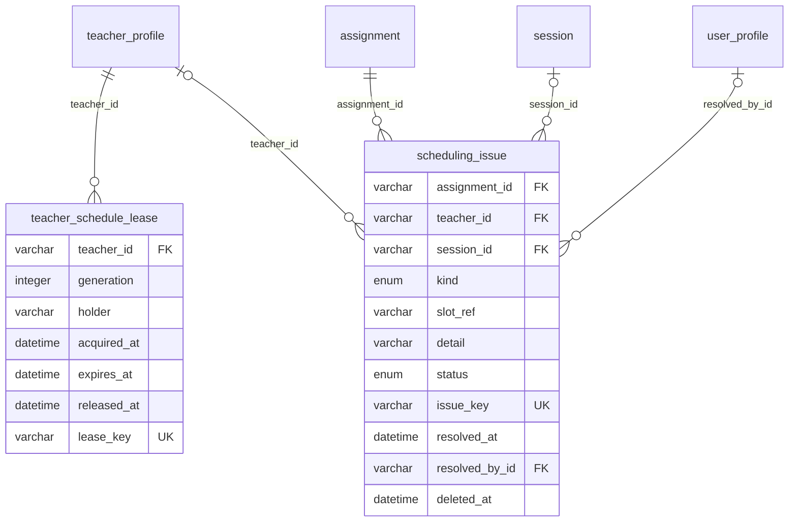

<!-- GENERATED by appwrite/schema_build.py from appwrite/schema/scheduling.json. Do not edit; run `python3 appwrite/schema_build.py --write`. -->
# ERD: scheduling

Session generation support (S01 #93): per-teacher lease rows that serialise session writes, and admin-visible scheduling issues (conflicts, leave, availability).

## Tables

- `teacher_schedule_lease` (hard): Row-based lease that serialises session creation and rescheduling per teacher (Appwrite has no advisory locks). One row per (teacher, generation); the row id and lease_key are derived from teacher and generation, so creating generation N+1 is an atomic claim (409 for the loser). A holder is valid only while its generation is the highest for the teacher and expires_at is in the future (fencing); a stalled holder finds a higher generation and stops. released_at is set on release. Holders delete rows older than the previous generation, so a teacher keeps one or two rows. Operational data, not business data: hard delete, no soft delete, no retention period.
- `scheduling_issue` (soft): Things the generator will not decide alone (S01 #93): a teacher clash, a slot outside the teacher's availability, a public holiday, a missing home location, missing or invalid preferred slots, fewer preferred slots than the plan's sessions per week, an inactive teacher, or an unexpected error. issue_key = '<kind>:<assignment_id>:<slot_ref or *>' while open and not soft-deleted, so re-running the job never duplicates an open issue; resolving or soft-deleting nulls it. Surfaced in the admin queue (M06/W-tickets).
