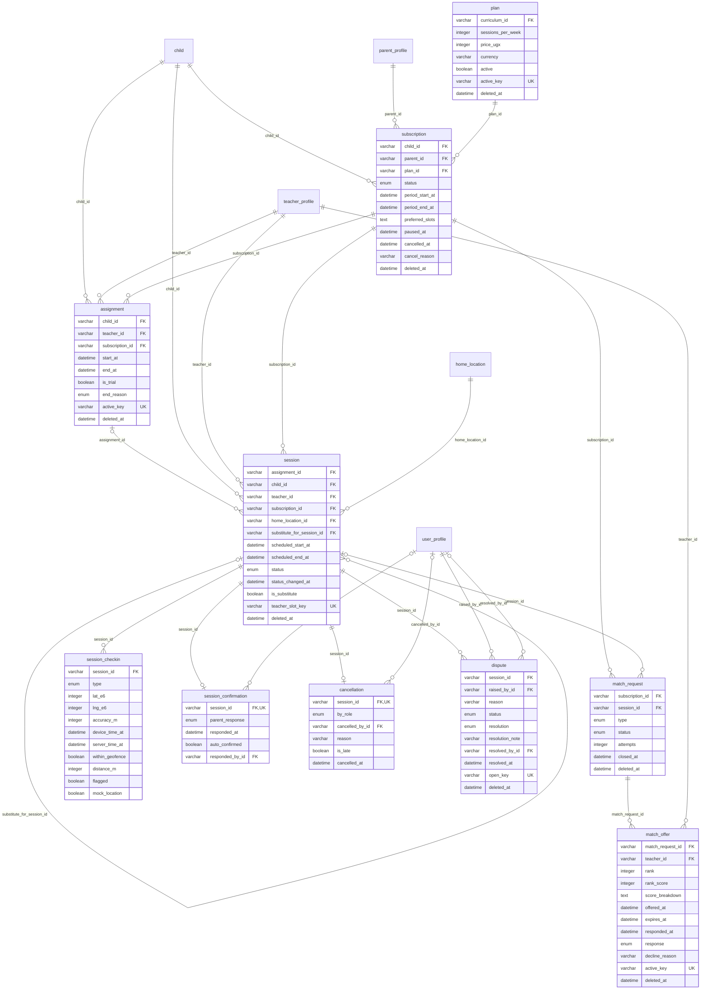

<!-- GENERATED by appwrite/schema_build.py from appwrite/schema/sessions.json. Do not edit; run `python3 appwrite/schema_build.py --write`. -->
# ERD: sessions

M02 (#37): plans, subscriptions, matching, assignments and sessions (SR 5.2, 7.2-7.4). Money integer UGX, instants UTC, coordinates integer micro-degrees. Unique constraints use derived *_key columns (soft-delete convention in appwrite/README.md).

## Tables

- `plan` (soft): price_ugx is integer UGX per billing period (SR 5.4/5.5), currency kept for future multi-currency. active_key = '<curriculum_id>:<sessions_per_week>' while active, null when inactive or soft-deleted: one active plan per curriculum and frequency; price changes = deactivate and add a new plan.
- `subscription` (soft): One per child and plan; parent_id denormalised for 'my subscriptions' lists. Status machine pending_payment/matching/active/paused/past_due/cancelled is enforced by the core service. period_* are UTC instants of the billing period. preferred_slots is JSON text [{weekday 1-7, start_minute, end_minute}] in Africa/Kampala wall-clock minutes (same convention as availability_slot). No unique (child) because a child may hold several subscriptions; duplicates are a core-service check.
- `match_request` (soft): type new|rematch|substitute (SR 7.2/7.3); session_id is set for substitute requests. attempts counts offers made; after 5 failures status becomes admin_queue. Teachers already rematched away from a child are derived from assignments with end_reason rematch_requested.
- `match_offer` (soft): Sequential offers (SR 7.2). rank is the position, rank_score is integer basis points 0-10000 (no floats), score_breakdown is JSON text {factor: basis points, weights_version} for transparency and tuning. active_key = '<match_request_id>:<teacher_id>' while response is pending, null once resolved or soft-deleted: unique index = one active offer per teacher per request, offers are idempotent.
- `assignment` (soft): Current teacher-child pairing. start_at/end_at UTC; is_trial marks a trial pairing; end_reason set when it ends. active_key = '<child_id>:<subscription_id>' while end_at is null and not soft-deleted: one active assignment per child per subscription (a trial counts; converting ends the trial with end_reason trial_converted and creates the regular one).
- `session` (soft): Status is an enum of exactly the SR 7.4 states; allowed transitions are enforced by the core service, not the schema (reference table: appwrite/session_rules.py ALLOWED_TRANSITIONS). Overlap rule: Appwrite has no exclusion constraint, so the core service checks the teacher's sessions for time overlap in the write path (session_rules.create_session) and the unique index on teacher_slot_key ('<teacher_id>|<UTC start>' while the session holds the slot, null for cancelled/no_show/void/soft-deleted) is the backstop for concurrent requests with the same start. Deviation from the ticket wording: derived key instead of raw (teacher_id, scheduled_start_at) so a cancelled session does not block re-booking the slot (soft-delete/unique convention). Substitute: a NEW session row for the same slot, is_substitute true, substitute_for_session_id = the session the teacher cancelled, assignment_id null. Indexes: by_teacher_day (teacher sessions by day), by_child_period (child sessions by period), by_status_changed (auto-confirmation job). Residual risk: the unique teacher_slot_key only catches the same start; two overlapping sessions with different starts can both insert, so the core service (W01 #97 / S01 #93) must serialise writes per teacher or re-check after insert.
- `session_checkin` (immutable): Insert-only evidence. lat_e6/lng_e6 integer micro-degrees (M01 convention), accuracy_m metres, device_time_at is the device clock, server_time_at is authoritative (VRF), distance_m to the home pin computed server-side, within_geofence null when not computed, flagged requires parent confirmation to count. Unique (session_id, type): one check-in and one check-out per session.
- `session_confirmation` (immutable): Parent response after check-out; auto_confirmed true when the hourly job confirms after 48 h without dispute (responded_by_id then null). One per session.
- `cancellation` (immutable): One per cancelled session. by_role parent|teacher|admin; is_late decides cancelled_by_parent_late vs cancelled_by_parent_ontime on the session (threshold is a core-service setting).
- `dispute` (soft): Raised by the parent after check-out (SR 7.4 disputed -> confirmed|void). open_key = session_id while status is not resolved, null after resolution or soft-delete: one open dispute per session.

## Relations to tables that arrive in later tickets

- `plan.curriculum_id` -> `curriculum`: catalogue tables arrive with the curriculum ticket
