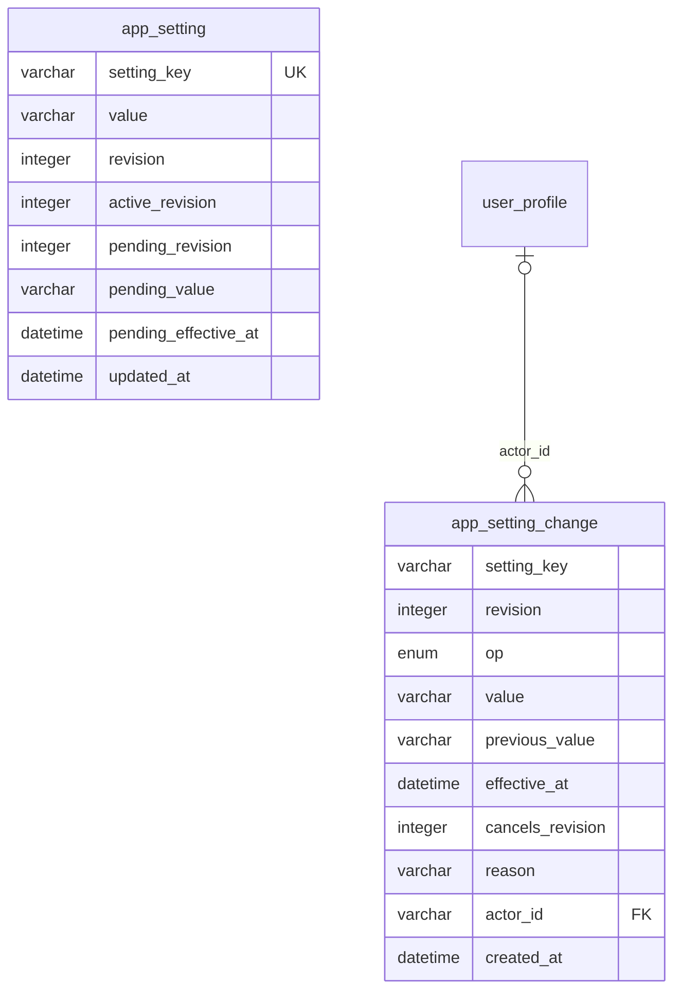

<!-- GENERATED by appwrite/schema_build.py from appwrite/schema/settings.json. Do not edit; run `python3 appwrite/schema_build.py --write`. -->
# ERD: settings

H05 (#134, NFR-18): business-rule settings the super admin changes without a release. app_setting_change is the history and the source of truth (one row per change, created and never updated or deleted by the core service; creating the row for revision N+1 is the optimistic-concurrency claim, since Appwrite has no conditional update). app_setting is a projection of that history for readers: the value in force, the revision it reflects and at most one scheduled change. Both are written only by the core service through the audited repository (M06); no client permission, no table-level read. Which settings exist, their bounds and defaults are declared in code (services/core/src/hs_core/app_settings/registry.py), not here.

## Tables

- `app_setting` (hard): One row per setting that has been changed at least once; a setting never changed has no row and reads as its default (environment value, then the code default). value is the canonical JSON of the value in force when the row was written; pending_* is the at most one scheduled change (it takes effect at pending_effective_at even before the settings-activate job projects it). revision is the latest history revision this row reflects: a row behind its history is re-projected by the next edit and by the settings-activate job. Rows are never deleted: a rollback is a new revision.
- `app_setting_change` (immutable): History of every settings change, newest revision wins: op set (new value), rollback (a new revision carrying the earlier value; history is never rewritten) or cancel (cancels the pending revision named by cancels_revision). Id is derived from (setting, revision) and unique_setting_revision enforces it, so the create IS the concurrency claim. value and previous_value are canonical JSON of non-secret business values. reason is the super admin's reason (scrubbed, at most 500 characters); the same change also has audit_log rows with before/after (M06). The core service writes these rows through the audited repository, which refuses update and delete for append-only tables; that is protection by wiring and convention (an opt-in wrapper, see appwrite/README.md), not enforcement by Appwrite, whose server key could still change a row. The table has no client write permission.
