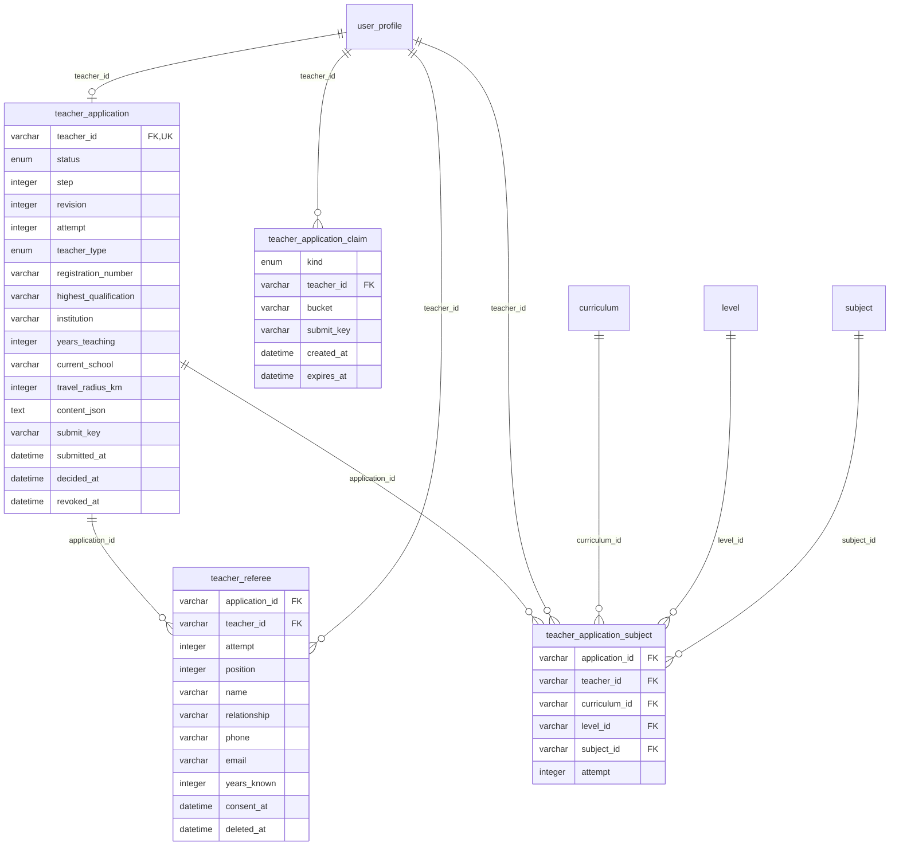

<!-- GENERATED by appwrite/schema_build.py from appwrite/schema/teacher_application.json. Do not edit; run `python3 appwrite/schema_build.py --write`. -->
# ERD: teacher_application

Teacher application wizard (V01, #56, SR VER-1, T-03..T-08): the draft and its status, the two referees, the subjects applied for, and server-only claim rows (submit exactly once, draft revision, rate limits). Final data lands in M01 tables on submit: teacher_profile (status pending), teacher_zone, availability_slot, teacher_approval REQUESTS (approved_at null; admin approves in V04).

## Tables

- `teacher_application` (history): Row id = the teacher's user id (create is the atomic one-per-teacher claim). status draft -> submitted -> under_review -> approved | not_approved | action_needed (V03/V04 own the transitions after submitted). content_json holds the wizard payload (personal details, curricula choice, referees, zones, availability) as validated by the core service; it is frozen from submit until the application is reopened. Typed columns duplicate the fields admins filter on. current_school and date of birth are private to the teacher and admins. revoked_at = application withdrawn (no hard delete). National ID numbers are NOT collected (SR T-05: ID images only, V02). Submitting leaves teacher_profile.status `pending` (the M01 enum has no `submitted`); admins find submitted applications through teacher_application.status (index by_status_submitted: status, submitted_at), see V04/A-05. The photo is not stored as a file reference by V01 (the phone keeps it until V02 uploads it).
- `teacher_referee` (soft): Two rows per application attempt (position 1 and 2). phone is E.164 normalised with the A01 rules. Not contacted by this ticket: V04 contacts referees and records checks. Rows of a resubmission are new rows (attempt+1); old ones keep their deleted_at set.
- `teacher_application_subject` (join): Subjects applied for per curriculum and level (teacher_approval is per curriculum and level only). Replaced as a set on resubmission.
- `teacher_application_claim` (hard): Server-only claim rows made with deterministic ids so a duplicate create (409) decides the winner (ADR 0002 idiom, same as otp_challenge): kind=submit one per (teacher, attempt) carrying the idempotency key; kind=revision one per (teacher, revision) so two saves from the same base revision cannot both win; kind=bucket rate-limit slots. Expired rows are deleted lazily by the writer.
